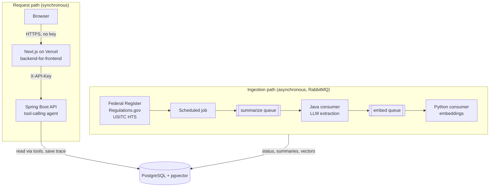

# Ingredient & Trade Market Intelligence Agent

An LLM agent that answers ingredient-sourcing questions ("what's the tariff risk on glycine from India?") using only evidence retrieved from three official U.S. trade-policy sources. It's backed by an asynchronous, failure-tested ingestion pipeline and deployed on AWS EC2.

**Live demo:** [market-intel-agent-bice.vercel.app](https://market-intel-agent-bice.vercel.app): ask a question and see the full tool-call trail, or browse the [data sources](https://market-intel-agent-bice.vercel.app/pipeline).

- **Problem:** Sourcing decisions depend on duties set by three different agencies: AD/CVD filings (Commerce, Federal Register), Section 301 actions (USTR) and base tariff rates (USITC). I did this analysis by hand in a previous role.
- **Built:** Tool-calling agent (Spring Boot + OpenAI) · Next.js + TypeScript dashboard · ingestion from 3 external sources · pgvector retrieval in PostgreSQL · RabbitMQ pipeline with Java and Python consumers · API-key auth · scripted EC2 deployment
- **Verified:** At-least-once delivery with idempotent consumers, proven by killing a consumer mid-flight · poison messages dead-lettered · automatic recovery after instance reboot
- **Measured:** retrieval evaluated on 17 hand-labeled queries; tuning the relevance gate and recency weight raised nDCG@5 from 0.78 to 0.93. → [Retrieval evaluation](#retrieval-evaluation)
- **Not yet:** HTTPS between the dashboard and the API, an answer-quality (groundedness) evaluation, unit tests. Tracked openly in [KNOWN_ISSUES.md](KNOWN_ISSUES.md)

## Engineering highlights

1. **Reliable async pipeline, not just "uses a queue."** Ingestion → LLM extraction → embedding runs through RabbitMQ with explicit row status, atomic claims via conditional `UPDATE`, retries with backoff, a dead-letter queue, and a scheduled reconciler for crashed workers. I verified each guarantee with fault injection. → [Ingestion pipeline](#ingestion-pipeline-asynchronous-path)
2. **Idempotency chosen by cost.** The expensive LLM step claims work before running; the cheap embedding step writes conditionally with no claim. → [ADR-006](#adr-006-choose-idempotency-by-the-cost-of-repeating-a-step)
3. **A bug that only appeared on one machine.** The stale-work reconciler silently matched nothing because a zone-less `TIMESTAMP` column was written from sessions in different time zones. Fixed with `TIMESTAMPTZ` and the database as the single clock. → [ADR-007](#adr-007-one-clock-for-pipeline-timestamps-timestamptz-written-by-the-database)
4. **LLM output treated as untrusted input.** Structured extraction returns `null` instead of guessing, and real filings forced handling for code fences, multi-country notices, issuing-vs-affected country confusion and inconsistent names. Every agent answer is stored with its full tool-call trace. On the answer side, the agent cannot cite another product's case as evidence: filing results are split into those that name the ingredient and country-wide actions marked "coverage unknown", and rules the model kept ignoring were moved out of the prompt and into the data it sees. Checked with a scripted smoke test, including positive cases. → [LLM extraction](#llm-extraction), [Query path](#how-a-query-works-synchronous-path)
5. **Three sources, each handled the way its data deserves.** Unstructured legal text (Federal Register, Regulations.gov) goes through LLM extraction; the structured USITC tariff API skips the LLM entirely and is diffed against a snapshot to emit change events. Documents published in both Regulations.gov and the Federal Register are deduplicated by FR document number. → [Data sources](#data-sources)
6. **The API key never reaches the browser.** The Next.js dashboard is a backend-for-frontend: the interactive page calls its own route handler, which adds the key server-side; the status page is a Server Component. The key module is marked `server-only`, so importing it from browser code fails the build. → [Dashboard](#dashboard)
7. **Retrieval tuned against a labeled eval set, which overturned a design assumption.** The ranking was designed so that recency only re-orders filings that already passed a similarity gate. Measured on 17 labeled queries, the gate at 0.30 removed nothing, so recency was promoting new irrelevant filings. Re-tuned with the data: precision 0.60 → 0.82, nDCG@5 0.78 → 0.93. → [Retrieval evaluation](#retrieval-evaluation)
8. **Production basics done properly.** Secrets never in the repo, generated server-side and never printed. Idempotent provisioning script. Rollback-safe JAR swaps. systemd recovery verified with a reboot. → [Deployment](#deployment)

## Example

Real output from the deployed agent (trimmed to three of five filings):

```text
$ curl -H "X-API-Key: ..." "http://<host>:8080/api/agent/query?q=glycine%20tariff%20risk"

1. Glycine From India: Preliminary Results and Rescission, in Part, of Countervailing Duty
   Administrative Review; 2024. Published 2026-09-14
   Commerce preliminarily determined that countervailable subsidies were provided to producers
   and exporters of glycine from India.
   Source: [Federal Register](https://www.federalregister.gov/documents/2026/09/14/2026-18719/...)

2. Glycine From India: Final Results of Antidumping Duty Administrative Review; 2023-2024;
   Correction. Published 2026-07-08
   Source: [Federal Register](https://www.federalregister.gov/documents/2026/07/08/2026-13780/...)

3. Glycine From India: Final Results of Countervailing Duty Administrative Review; 2023.
   Published 2026-06-16
   Source: [Federal Register](https://www.federalregister.gov/documents/2026/06/16/2026-12103/...)
...

Bottom line: The latest findings indicate ongoing scrutiny of glycine imports from India,
with risk from both countervailing and antidumping duties.
```

Every claim comes from a tool result and links to its source filing, and recent filings rank first (see [retrieval ranking](#how-a-query-works-synchronous-path)). One known gap: the model doesn't reliably flag when a preliminary result has been superseded by the final result for the same review period. The fix is structural (extract case, review period and stage as fields) rather than more prompting. See [KNOWN_ISSUES.md](KNOWN_ISSUES.md).

## What would change at larger scale

The current design is a single instance on purpose, because the data volume doesn't justify more. The parts that would change first:

- **Consumers scale horizontally as-is.** Claims are atomic conditional updates, so N consumer replicas can share a queue safely. The next step is running them as separate deployments (e.g. Kubernetes) and autoscaling on queue depth.
- **Dual writes → transactional outbox.** "Write DB, then publish" is currently covered by a scheduled re-publish. At higher volume, an outbox table written in the same transaction removes that gap entirely.
- **Retrieval:** add an HNSW index on the embedding column and move to managed PostgreSQL with read replicas, so query traffic is isolated from ingestion writes.
- **Observability:** metrics and alerts on queue depth, DLQ size, LLM latency and error rate, which today are checked by hand.

---

## Why this exists

As a Business Operations Analyst at an international ingredients distributor, I supported a $1M Maltitol Syrup purchase order by manually tracking tariff policy and supply conditions to guide a customer's sourcing decision. That analysis meant reading Federal Register notices, working out which country and product a duty applied to, and judging whether it was still in force.

This project rebuilds that workflow as a system: ingest the filings continuously, extract structured facts from unstructured legal text, and let an LLM answer questions **only from retrieved evidence**, with a trace of which tools it called.

---

## Architecture



The dashboard runs on Vercel; everything else runs on one EC2 instance: Spring Boot API, PostgreSQL 16 + pgvector, RabbitMQ, and the Python consumer.

**The sync/async boundary is the core design decision.** User queries read only from the database and return in seconds. Fetching, LLM extraction and embedding happen in the background, so a slow or failing external API (any of the three sources, or OpenAI) never blocks or breaks a user-facing request.

---

## How a query works (synchronous path)

1. `GET /api/agent/query?q=...` with an `X-API-Key` header (custom Spring Security filter, constant-time comparison).
2. `AgentOrchestrationService` sends the question to `gpt-4o-mini` with four tool definitions and runs a bounded loop (max 4 rounds): the model chooses tools, the service executes them against PostgreSQL, results go back to the model as `tool` messages.
3. `search_market_events` embeds the query and runs a pgvector cosine search in two stages:
   - **Relevance gate:** similarity threshold (0.45), one result per source document (`DISTINCT ON (source_url)`). HTS baseline snapshots are excluded: they are dated by fetch time, so recency treated them as the newest document in every query, and the base duty comes from `get_tariff_rate` anyway. If nothing passes, the three closest filings are returned under a "low confidence" label instead of an empty result (see finding 6 below).
   - **Ranking:** `score = similarity × (0.75 + 0.25 × 0.5^(age_days / 365))`. Recency re-orders what passed the gate, so the newest filing in a case comes first; the floor of 0.75 keeps older filings in play, since AD/CVD orders typically run for five years. Recency is only safe if the gate actually removes irrelevant filings. Both values were chosen with the eval set below.

   `get_market_events(country, ingredient)` returns two labelled groups: filings whose title or summary names the ingredient (newest first, up to 10), and the latest country-wide Section 301 actions, marked as not confirmed to cover the ingredient. With no matching filing it says "no filing in this data names X", not "no duties". It rejects "United States" as the country (every filing is a U.S. action *on* imports), which the model sometimes confused. `get_tariff_rate` returns the base (MFN) duty for an ingredient from the USITC tariff schedule, explicitly labelled as excluding AD/CVD and Section 301 duties; column-2 and special-program rates are left out because they don't apply to the sourcing countries and the model kept quoting them.
4. A system prompt restricts the model to tool results, requires a publication date and source link for every filing mentioned, asks it to lead with the most recent evidence, and to report base duty and AD/CVD duties separately rather than adding them up. It must not present a filing about another product as relevant, must not guess whether a Section 301 action covers the ingredient, and must call both the filings and tariff tools for any risk or duty question. Requests use `temperature: 0` and a fixed `seed`, so the same question gives the same tool calls. A failing tool returns an error message to the model instead of failing the request.
5. The final answer is stored in `recommendations` together with the full tool-call trace (`reasoning_trace` JSONB): which tool, which arguments, in which round.

---

## Retrieval evaluation

The first version of the ranking rested on an assumption I had not tested: that the 0.30 similarity gate removes irrelevant filings, so recency only re-orders relevant ones. To test it I built a small eval set in [`eval/`](eval):

- **17 queries** in six categories: exact product + country, abbreviation ("MSG"), paraphrase ("food thickener" for xanthan gum), country-wide actions, products with no filing in the data, and an out-of-domain query.
- **164 (query, filing) pairs**, pooled from the top 5 of every configuration tested and graded by hand: 2 = about this product (and country), 1 = partially useful (e.g. a country-wide Section 301 action), 0 = not useful.
- **Metrics:** precision and recall@5 for the gate; nDCG@5 and "newest relevant filing first" for the ranking; junk returned for queries that have no answer.

| Configuration | Precision | Recall@5 | nDCG@5 | Newest relevant first | Junk per no-answer query |
|---|---|---|---|---|---|
| Before: gate 0.30, recency weight 0.5, all event types | 0.60 | 0.73 | 0.78 | 77% | 4.25 |
| Reference: gate 0.45, recency off | 0.90 | 0.98 | 0.99 | 42% | 3.60 |
| **Now: gate 0.45, recency weight 0.25, HTS baselines excluded** | **0.82** | **0.90** | **0.93** | **75%** | **3.60** |

With HTS baselines excluded, the stevia query has no matching filing left (its only relevant result was the stevia base duty, which `get_tariff_rate` provides), so the last two rows average junk over 5 no-answer queries instead of 4.

What the data showed:

1. **The 0.30 gate removed nothing.** Every filing in this corpus is trade-policy text, so with `text-embedding-3-small` even unrelated filings score above 0.30 (irrelevant pairs: median 0.46, max 0.60). Thresholds of 0.20, 0.25 and 0.30 returned identical results.
2. **So recency was promoting new irrelevant filings.** Turning recency off raised nDCG@5 from 0.78 to 0.99 but put the newest relevant filing first only 23% of the time. A smaller weight (0.25) keeps most of the freshness benefit at a small relevance cost.
3. **HTS baseline snapshots looked like the newest documents** because they are dated by fetch time, and appeared as junk in queries about other products.
4. **No single threshold separates relevant from irrelevant.** Relevant pairs: median similarity 0.64, 10th percentile 0.48. A gate at 0.45 keeps 95% of relevant pairs but removes only 44% of junk; 0.55 removes 84% of junk but loses 30% of relevant pairs and leaves 3 answerable queries with no result. Queries with no answer still get ~3.6 irrelevant filings. The next step is a second signal, such as a keyword match on the product name (hybrid retrieval), rather than a higher threshold.
5. **The embedding barely encodes the country.** After tuning, most queries reach nDCG@5 1.00 and the abbreviation query "MSG tariff China" rose from 0.47 to 0.86. The weakest is now "antidumping duty on glycine from China" (0.48): glycine filings from India rank above those from China. Country is a structured fact and belongs in a filter, as `get_market_events` already does, not in vector similarity.
6. **The agent does not search with the kind of query the gate was tuned on.** An end-to-end smoke test caught what the offline eval could not. Asked "What trade cases involve amino acids used in supplements?", the model searched for "amino acids supplements". The five closest filings were all glycine filings, so the ranking was right, but their similarity was only 0.32–0.34 and the gate returned nothing. The eval-style wording "amino acid supplement duties from India" scores 0.51 against the same filings, and for the agent's "dumping cases food thickeners" only one of five xanthan gum filings (0.44–0.46) passes the gate. Short keyword queries score lower against every filing, so a fixed similarity threshold means something different for each query. Lowering the gate would not help, because 0.32–0.34 is where irrelevant filings sit for other queries. Instead, search falls back to the three closest filings, labeled low confidence, and the model judges them. The cost is on queries with no answer: "ascorbic acid vitamin C duties", the one no-answer query the gate used to clean completely, now gets three low-confidence filings, which the system prompt forbids presenting as relevant. Missing a real case is worse for a buyer than being shown a labeled near-miss, and the model can filter a near-miss but cannot recover a filing it never saw. The queries the agent actually sent are now in the eval set as a separate category, reported but not used for tuning.

Labeling also surfaced data problems that are now tracked in [KNOWN_ISSUES.md](KNOWN_ISSUES.md): a placeholder value `All (MFN)` in the `country` column, multi-country filings stored as one row per country, Section 301 notices classified differently depending on the source API, and one filing extracted with the wrong country.

**Caveats:** 17 tuning queries graded by one person on a local snapshot of the data. The numbers show direction, not precision; values were picked at the point where the trade-off flattens rather than at the single best score, to avoid fitting this small set. Full results: [`eval/results.md`](eval/results.md), [`eval/similarity.md`](eval/similarity.md); method and labeling rules: [`eval/README.md`](eval/README.md).

---

## Ingestion pipeline (asynchronous path)

### Status lifecycle

Every `market_events` row carries an explicit status instead of inferring progress from `NULL` columns:

```
PENDING ──▶ SUMMARIZING ──▶ SUMMARIZED ──▶ EMBEDDED
                 │
                 └── stale for > 10 min ──▶ reset to PENDING by the reconciler
```

### Reliability guarantees

| Concern | Mechanism |
|---|---|
| A message is never lost | Durable queues, persistent messages, manual ack **after** the DB commit |
| Duplicate delivery is harmless (at-least-once) | Consumers check status first; claims use a conditional update (`UPDATE … WHERE id = ? AND status = 'PENDING'`, proceed only if 1 row changed) |
| Two consumers never process the same row | The same conditional update: row-level locking makes the claim atomic |
| No duplicate records | Unique index on `(source_url, country)` |
| Transient failures recover | 3 attempts with exponential backoff (2 s, 4 s), Java and Python consumers |
| Poison messages don't block the queue | After retries, messages are rejected without requeue and dead-lettered to `events.dlq` |
| Consumer crashes after claiming a row | Scheduled reconciler resets rows stuck in `SUMMARIZING` |
| Crash between DB write and the next publish | Scheduled job re-publishes `SUMMARIZED` rows to `events.embed`; the embed write is idempotent |

### Verified with failure drills

- **Poison message:** published a non-JSON payload to `events.summarize` → retried 3×, then dead-lettered with an `x-death` header (`reason: rejected`); the queue kept flowing.
- **Crash after commit, before ack:** killed the embed consumer with `SIGKILL` between the DB commit and the ack (fault-injection delay) → the broker redelivered the message and the consumer logged `already embedded, skipping`. No duplicate API call, no duplicate write.
- **Crash after claim:** left a row in `SUMMARIZING` with an old timestamp → the next scheduled run reset it, and it completed end-to-end.

### LLM extraction

`TariffSummarizerService` asks the model for structured JSON (affected country, old/new rate, effective date, one-sentence summary) and to return `null` rather than guess. Real filings required handling:
- JSON wrapped in markdown code fences
- one notice covering several countries → one row per country, sharing `source_url`
- the model naming the issuing country (U.S.) instead of the affected one → explicit prompt instruction
- inconsistent country names (`People's Republic of China`, `PRC`) → normalization
- non-ISO dates (`July 29, 2024`) → multi-format parsing

---

## Data sources

A U.S. import duty is set by three agencies. Each source covers one of them:

| Source | Agency / what it answers | Access | Path through the pipeline |
|---|---|---|---|
| **Federal Register API** | Commerce AD/CVD filings: *is there a duty case on this product, and at what rate?* | JSON API, keyword search per ingredient + trade-remedy filter | LLM extraction → embedding |
| **Regulations.gov API** | USTR Section 301 actions: *are country-wide tariffs being imposed or extended?* | JSON API (api.data.gov key), scoped to USTR, filtered to notices/rules with tariff terms | LLM extraction → embedding. Skipped if the same document is already held as a Federal Register filing (matched by FR document number). Title enriched with the FR abstract when available |
| **USITC HTS REST API** | Base (MFN) duty per ingredient: *what is the normal tariff before any extra duties?* | JSON API, curated ingredient → 10-digit HTS mapping verified against the API | **No LLM** (already structured). Compared with a `tariff_rates` snapshot; an event is emitted on first observation and on any rate change. 10-digit statistical lines inherit the rate of their 8-digit tariff line |

**Current volume:** 100 Federal Register filings (122 rows, one per affected country), 16 USTR documents, 10 HTS tariff lines, across 15+ countries; 27 ingredient records across 5 categories with category-specific specs in JSONB.

Sources that were evaluated and rejected: USITC news releases (HTTP 403 for non-browser clients) and CBP CSMS via GovDelivery RSS (HTTP 406). Scraping sites that actively block clients would make a scheduled job unreliable.

---

## Dashboard

Next.js 15 (App Router) + TypeScript in [`frontend/`](frontend), deployed on Vercel.

| Page | Rendering | What it shows |
|---|---|---|
| **Ask** (`/`) | Server Component loads the tracked tariff lines; the interactive part is a Client Component that calls the `/api/query` route handler → Spring Boot | A question box, ingredient tags (name, base duty, HTS line; one click asks about it), and the answer with every duty figure highlighted and linked to its source, plus "How this answer was checked": each lookup in plain language with the source it read; the raw data is one click away. The last answer is kept per browser tab (`sessionStorage`) |
| **Data sources** (`/pipeline`) | Server Component, rendered on the server | Documents per source and agency, base tariff per ingredient, recent ingestion runs (from `ingestion_runs`). Times are shown in U.S. Eastern with the zone named, since the server renders in UTC |

- **Secrets stay server-side.** `BACKEND_API_KEY` is read only in `lib/backend.ts`, which imports `server-only`; the build output marks every key-using route as server-rendered (`ƒ`).
- **Cost guard.** Each question triggers paid LLM calls, so the proxy validates input length and rate-limits per client (10 questions per 10 minutes). The limiter is in-memory, so on serverless it is per instance; a shared store (e.g. Redis) would be needed for a hard guarantee. See [KNOWN_ISSUES.md](KNOWN_ISSUES.md).
- **Dependencies are pinned and audited.** The first deploy was blocked by Vercel for a vulnerable Next.js version (CVE-2025-66478); upgraded to a patched 15.5.x and overrode two vulnerable transitive packages instead of jumping a major version.

## Deployment

Single AWS EC2 instance (t3.micro, Ubuntu 24.04):

- Spring Boot JAR and the Python consumer run as **systemd** services (`Restart=on-failure` / `always`); both recover automatically after an instance reboot (verified).
- **Security Groups:** SSH restricted to a single client IP; RabbitMQ and PostgreSQL are not exposed publicly; the RabbitMQ management UI is not installed on the server.
- **Secrets** live in `EnvironmentFile`s (`chmod 600`), never in the repository. The RabbitMQ password is generated on the server and never printed; the default `guest` user is removed.
- **Provisioning is scripted:** [`deploy/setup_pipeline.sh`](deploy/setup_pipeline.sh) is idempotent: install, migrate, configure, restart, verify.
- **Deploys** upload `app.jar.new`, then stop → keep `app.jar.bak` for rollback → swap → start.
- **Dashboard** deploys automatically from `main` on Vercel (root directory `frontend`); `BACKEND_URL` and `BACKEND_API_KEY` are Vercel environment variables, the key marked sensitive.

---

## Architecture Decision Records

### ADR-001: PostgreSQL + pgvector instead of a separate vector database
**Context:** The agent needs structured queries (ingredients, filings by country) and semantic search over filing text.
**Decision:** Keep both in PostgreSQL with the `pgvector` extension.
**Consequences:** One database to run, back up and secure; structured and vector predicates can be combined in a single SQL statement. Trade-off: fewer specialized vector-search features than a dedicated vector store, which is acceptable at this scale.

### ADR-002: RabbitMQ instead of Kafka
**Context:** Background ingestion must not block the request path and must retry independently.
**Decision:** RabbitMQ with a direct exchange (`market.events`), one queue per stage, and a dead-letter exchange.
**Consequences:** The workload is task-oriented (process each filing once, then ack), not a replayable high-throughput event log, which is exactly RabbitMQ's model. Per-message ack, retries and dead-lettering come built in. Kafka's partitions, offsets and retention would add operational weight this workload doesn't use.

### ADR-003: Spring Boot core, Python for embeddings, and the queue as the language boundary
**Context:** The core backend needs Spring's reliability tooling; embedding generation is a narrow job.
**Decision:** Java owns the API, orchestration, summarization consumer and the queue definitions; a small Python consumer owns embedding. They share only a JSON message contract (`{"eventId": N}`) and the database.
**Consequences:** Messages carry IDs, not payloads, so the database stays the source of truth and consumers always read the latest state. The Python consumer doesn't declare queues (re-declaring with different arguments fails with `PRECONDITION_FAILED`), so queue configuration has a single owner.

### ADR-004: A bounded tool-calling loop instead of an agent framework
**Context:** The agent coordinates tool calls and answer generation over several steps.
**Decision:** Implement the loop directly against the OpenAI Chat Completions API (max 4 rounds), not LangChain/LangGraph.
**Consequences:** Every step is visible and logged: messages, tool calls, arguments, results. The trace is persisted, and the round limit bounds cost and latency. The trade-off is writing plumbing a framework would provide; at three tools that's a small cost for full control. If the flow grows into fixed multi-stage plans, an explicit state machine is the next step.

### ADR-005: LLM structured extraction instead of regex for tariff parsing
**Context:** The original regex (`\d+\s*percent`) failed on real filings that phrase rate changes as multi-clause sentences with unresolved future values.
**Decision:** Extract structured JSON with an LLM, instructed to return `null` rather than guess.
**Consequences:** Handles ambiguous legal phrasing and multi-country notices, at the cost of an API call per filing and non-determinism, which the asynchronous pipeline absorbs. Regex-extracted columns are kept for a planned before/after accuracy comparison.

### ADR-006: Choose idempotency by the cost of repeating a step
**Context:** At-least-once delivery means every consumer will occasionally see the same message twice.
**Decision:** The summarize step **claims first** (`PENDING → SUMMARIZING` via conditional update) because an LLM call is expensive. The embed step **writes conditionally** (`… WHERE status = 'SUMMARIZED'`) with no separate claim, because a duplicate embedding call costs fractions of a cent.
**Consequences:** The expensive step can't run twice concurrently; the cheap step stays simple. Claims introduce a "stuck claim" failure mode, which is covered by the reconciler.

### ADR-007: One clock for pipeline timestamps (`TIMESTAMPTZ`, written by the database)
**Context:** The reconciler compares `status_updated_at` with "10 minutes ago". With a zone-less `TIMESTAMP` column, values written from sessions in different time zones (JVM vs. `psql`) were hours apart for the same instant, and the reconciler silently matched nothing.
**Decision:** Store `TIMESTAMPTZ`; only the database writes the column (`now()`; the entity field is `insertable = false, updatable = false`); the staleness threshold is computed in SQL.
**Consequences:** Comparisons are between absolute instants from a single clock, independent of server, JVM or session time zones. The bug only showed up on a machine whose zones differed, which is why it's recorded here.

---

## Roadmap

Not built yet (tracked in [KNOWN_ISSUES.md](KNOWN_ISSUES.md)):

- [ ] **HTTPS on the API** (the Vercel → EC2 hop is plain HTTP today)
- [ ] Shared rate limiter for the dashboard proxy
- [x] Retrieval eval set (17 labeled queries) and tuning of the gate and recency weight
- [ ] Eval queries taken from the searches the agent actually sends (`recommendations.reasoning_trace`), then re-tune
- [ ] Second signal for the relevance gate, e.g. a keyword match on the product name (hybrid retrieval); re-measure with the same eval set
- [ ] One row per filing with a filing–country table, so multi-country filings keep all their countries
- [ ] Answer groundedness evaluation
- [ ] Unit tests (pure functions and the auth filter first)

**Deliberately out of scope:** streaming responses, fine-tuning, multi-agent setups, Kubernetes/microservices. None of them are warranted at this scale.

---

## Running locally

Prerequisites: Java 17, PostgreSQL 16 with `pgvector`, RabbitMQ (`brew install rabbitmq`), Python 3.12, an OpenAI API key.

```bash
# 1. Database: create market_intelligence, enable pgvector, then apply db/ migrations

# 2. Config (gitignored): src/main/resources/application-local.properties
#    spring.datasource.url / username / password, openai.api.key, app.api-key

# 3. API + summarize consumer
./mvnw spring-boot:run -Dspring-boot.run.profiles=local

# 4. Embed consumer (embedding-script/.env: OPENAI_API_KEY, DB_NAME, DB_USER)
cd embedding-script && python -m venv .venv && source .venv/bin/activate
pip install pika psycopg2-binary requests python-dotenv
python embed_consumer.py

# 5. Trigger one ingestion run (local profile only), then query
curl http://localhost:8080/test/run-ingestion
curl -H "X-API-Key: <your local key>" "http://localhost:8080/api/agent/query?q=glycine%20tariff%20risk"
./scripts/agent_smoke_test.sh    # 5 ingredient questions, 3 semantic-search checks (PASS/WARN/FAIL), a repeatability check

# 6. Dashboard (frontend/.env.local: BACKEND_URL, BACKEND_API_KEY; see .env.local.example)
cd frontend && npm install && npm run dev    # http://localhost:3000
```

In production the ingestion job runs on a schedule (weekdays 9:00 America/New_York) when `APP_INGESTION_ENABLED=true`.

---

## Repository layout

```
src/main/java/.../
  AgentController, AgentOrchestrationService, AgentToolService   # synchronous agent path
  EmbeddingService                                               # query embeddings for retrieval
  IngestionJob, MarketEventFetcher                               # scheduled producer + reconciler
  RabbitConfig, EventPublisher, SummarizeConsumer, EventStatus   # async pipeline
  TariffSummarizerService                                        # LLM structured extraction
  SecurityConfig, ApiKeyFilter                                   # API-key auth
  HtsRateFetcher, RegulationsGovFetcher                          # data sources 2 and 3
  PipelineStatusController, AdminController                      # status page data, manual ingestion trigger
embedding-script/embed_consumer.py    # Python embed consumer
frontend/                             # Next.js + TypeScript dashboard (BFF)
db/                                   # SQL migrations
deploy/setup_pipeline.sh              # idempotent EC2 provisioning
scripts/agent_smoke_test.sh           # end-to-end agent check against a running backend
eval/                                 # retrieval evaluation: query set, human labels, script, results
KNOWN_ISSUES.md                       # known limitations and changelog
```

## Tech stack

Java 17 · Spring Boot 4 · Spring Security · Spring AMQP · Hibernate 7 · PostgreSQL 16 + pgvector · RabbitMQ · Python (pika, psycopg2) · OpenAI API (`gpt-4o-mini`, `text-embedding-3-small`) · Next.js 15 + TypeScript · AWS EC2 · Vercel · systemd
